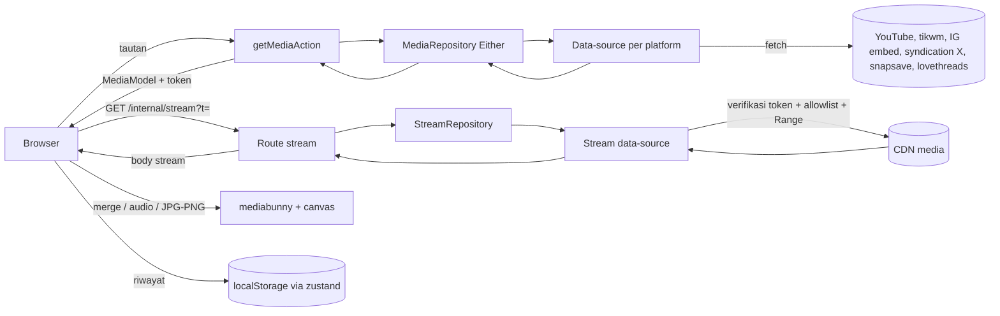
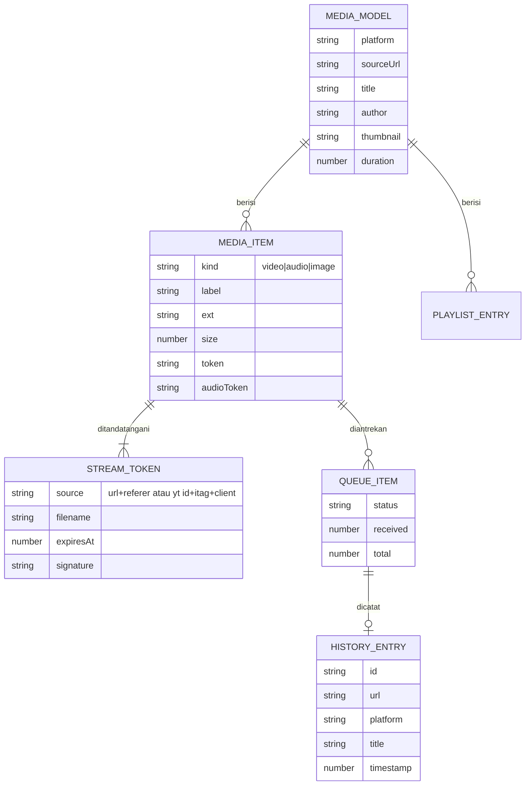
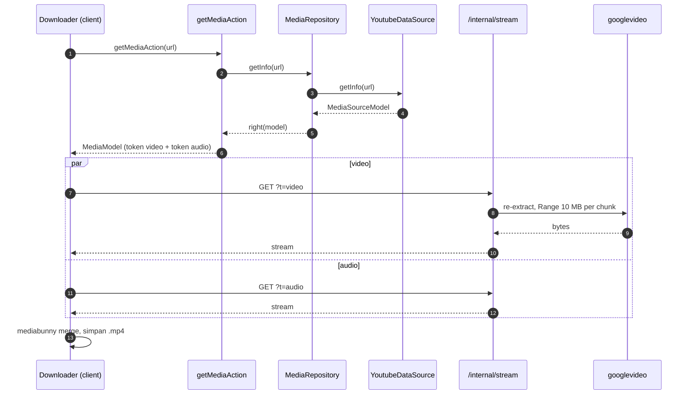
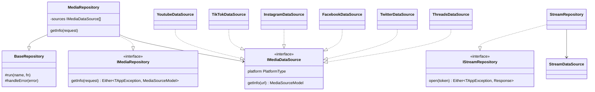

# Refactor arsitektur, perbaikan `spawn yt-dlp ENOENT`, dan redesign

Status: **selesai, menunggu uji di preview Vercel**. Dokumen ini melanjutkan `docs/vercel-migration.md` (F0 spike sudah lolos) dan menggantikan fase F1 sampai F5 di sana. Bagian "Hasil" di akhir diisi dengan angka nyata saat eksekusi.

## 1. Permintaan dan keputusan

| Keputusan | Pilihan | Sumber |
|---|---|---|
| Arsitektur | Ikuti `ARCHITECTURE.md` (layer `domain` / `data` / `common` / `core`, tsyringe, Either fp-ts, zustand slice) | Permintaan user |
| Error `spawn yt-dlp ENOENT` | Hapus semua pemanggilan binary (`yt-dlp`, `ffmpeg`, `gallery-dl`, `python3`). Ganti dengan `fetch` ke sumber publik | Review §2 |
| Gabung video + audio YouTube 480p ke atas | Di browser, tanpa re-encode, pakai `mediabunny` (TypeScript murni, tanpa wasm) | Menggantikan rencana ffmpeg.wasm (alasan di §6) |
| Bahasa copy | Indonesia, sapaan "kamu" | Jawaban user |
| Brand | Tetap SaveIt | Jawaban user |
| Arah visual | Tenang dan editorial, hangat. Dial ENERGY 2 / RHYTHM 2 / MOTION 1 | Jawaban user |
| Tema | Hanya terang. Tidak ada dark mode | Jawaban user (override R-21 antislop dicatat) |
| Lebar minimum | 360px, mobile first | Permintaan user |
| Antislop | Mode during | Jawaban user |

## 2. Review (kondisi sebelum refactor)

### 2.1 Alur hari ini

1. Halaman platform (`src/app/<platform>/<platform>-downloader.tsx`) memanggil `get*InfoAction` di `src/actions/*.action.ts`.
2. Action memanggil service di `src/core/services/*.service.ts`. Service menjalankan `yt-dlp -J` lewat `yt-dlp-wrap` (`youtube.service.ts:175`, `tiktok.service.ts:164`, `twitter.service.ts:88`, `facebook.service.ts:124`, `instagram.service.ts:212`, `threads.service.ts:123`).
3. Untuk unduh, client `POST /internal/progress/start` (`src/core/hooks/use-batch-download.ts:91`). Server memanggil route miliknya sendiri yang menjalankan `yt-dlp -o -` lalu `ffmpeg` (`src/core/server/media-compat.ts`), menulis ke `os.tmpdir()`, lalu client polling status tiap 700 ms.

### 2.2 Tabel temuan

| # | Lokasi | Masalah | Dampak |
|---|---|---|---|
| 1 | `src/core/services/*.service.ts` (6 file) | `new YTDlpWrap("yt-dlp")` lalu `execPromise` / `execStream` | Runtime tanpa binary `yt-dlp` gagal dengan `spawn yt-dlp ENOENT`. Semua platform mati untuk info dan unduh |
| 2 | `src/core/services/social-image.service.ts:473`, `:544` | `gallery-dl` dan `python3 -c instaloader` | Gagal diam-diam (`Promise.allSettled`), hasil gambar Instagram/FB kosong |
| 3 | `src/app/internal/media/image/route.ts:69`, `media/video/route.ts:52`, `src/core/server/media-compat.ts:71` | `spawn("ffmpeg")` untuk konversi gambar, MP3, remux | Gagal di runtime tanpa ffmpeg |
| 4 | `src/core/server/download-job-store.ts:41` | Job store `Map` di memori + file temp | Di serverless status dan file tidak dibagi antar instance, polling 404 |
| 5 | `src/app/internal/preview/instagram/route.ts:25` | Allowlist host `endsWith` tanpa batas titik, redirect diikuti | SSRF |
| 6 | `src/app/*/<platform>-downloader.tsx` (6 file, 264 sampai 435 baris) | Logika fetch, kualitas, antrean, riwayat diulang di tiap halaman | Duplikasi besar, perbaikan harus dilakukan 6 kali |
| 7 | `src/app/page.tsx`, `src/app/globals.css` | Tema gelap, gradien biru-ungu, grid latar, emoji sebagai ikon, angka tanpa sumber ("0 seconds sign-up time") | Tidak sesuai permintaan desain dan gagal filter antislop (R-01, R-07, R-17, emoji) |
| 8 | Struktur `src/` | `src/actions`, `src/core/services`, `src/core/utils`, `src/core/hooks` | Tidak sesuai layering `ARCHITECTURE.md` |
| 9 | `src/app/internal/spike/*`, `src/app/spike/*` | Kode spike F0 | Sementara, dihapus |
| 10 | `package.json` | ESLint, `yt-dlp-wrap`, `@tobyg74/tiktok-api-dl` | ARCHITECTURE memakai oxlint + oxfmt; dua dependency tidak terpakai setelah refactor |

### 2.3 Hasil uji sumber data tanpa binary (IP lokal, 2026-10-29)

| Platform | Sumber | Hasil |
|---|---|---|
| YouTube | `youtubei.js` 18.3.0, client `ANDROID` (progressive 360p) dan `IOS` (adaptive mp4 + audio m4a) | Info 160 ms. Itag 18: 11,8 MB dalam 2,2 s. Adaptive tanpa Range dibatasi kecepatannya (audio 35 KB/s). Dengan header `Range` per 10 MB: 10 MB dalam 1,1 s. Semua URL tanpa CORS |
| TikTok | `tikwm.com/api` | `code: 0`, field `hdplay`, `play`, `wmplay`, `music`, `images`, `cover`, `author`, `duration` |
| Instagram | `/<p|reel>/<kode>/embed/captioned/`, field `contextJSON` | `shortcode_media` berisi `is_video`, `video_url`, `display_url`, `owner.username`, `edge_sidecar_to_children` |
| X | `cdn.syndication.twimg.com/tweet-result` | 200 untuk tweet video publik |
| Threads | `lovethreads.net/api/ajaxSearch` | Endpoint merespons (`status: ok`); post contoh di test bersifat privat |
| Facebook | `snapsave.app/action.php` + `decodeSnapSaveResponse` | Endpoint merespons dan ter-decode; link contoh di test privat. Perlu URL video publik untuk uji akhir |

### 2.4 Batasan

- Tanpa database, tanpa login. Bagian ARCHITECTURE tentang Postgres, sesi, RBAC, `proxy.ts`, dan pipeline `ky` tidak berlaku.
- URL googlevideo terikat IP pengekstrak. Ekstraksi ulang dilakukan di invocation yang sama dengan stream.
- CDN media tidak mengirim CORS, jadi semua unduhan lewat proxy `/internal/stream`.
- Endpoint pihak ketiga (tikwm, snapsave, lovethreads, syndication) tidak resmi dan bisa berubah. Satu data-source per sumber agar mudah diganti.
- Vercel Hobby: durasi function maks 300 s, kuota Fast Data Transfer. Batas ukuran response streaming harus diuji di preview deploy.

## 3. Penerapan ARCHITECTURE.md

| Bagian | Penerapan |
|---|---|
| §2 struktur folder | `app`, `components/<kategori>`, `common` (`di`, `lib`, `hooks`, `constants`, `stores`), `core` (`handler`, `types`, `services`), `data`, `domain` |
| §3 DI tsyringe | `common/di/injection.ts`, token string = nama interface. Enam data-source platform didaftarkan ke token `IMediaDataSource`, repository memakai `@injectAll` |
| §3 Either fp-ts | `IMediaRepository` dan `IStreamRepository` mengembalikan `Either<TAppException, T>` |
| Logger Pino | `core/services/logger.ts`, dipakai `BaseRepository.run` (traceId + durasi) |
| HMAC SignatureManager | `core/services/encrypt-manager.ts`, menandatangani token stream (expiry 30 menit) |
| §7 komponen | shadcn `button`, `input` di `components/ui`; komponen global per kategori (`components/layout`, `components/download`, `components/icon`, `components/feedback`); komponen satu halaman tetap di folder route |
| §8 Zustand | Satu store, slice `history` (persist), pasangan hook `useHistory` / `useHistoryActions` |
| Lint/format | oxlint + oxfmt menggantikan ESLint |
| Framer Motion | Tidak dipasang. Dial MOTION 1 cukup dengan transisi CSS; tambah saat ada interaksi yang butuh spring |

Satu domain `media`, bukan slice per platform: bentuk info keenam platform sama (judul, penulis, thumbnail, daftar file). Bedanya hanya cara mengambil, dan itu tugas data-source. Ini memangkas 18 file repository/action yang isinya identik.

## 4. Struktur target

```text
src/
  app/
    layout.tsx, page.tsx (landing), globals.css, robots.ts, sitemap.ts
    components/hero-link-form.tsx         hanya dipakai landing
    <platform>/page.tsx                   6 halaman tipis: metadata + <PlatformPage id="..."/>
    history/page.tsx + components/history-list.tsx
    internal/stream/route.ts              satu-satunya route media
  components/
    ui/button.tsx, input.tsx              shadcn, ukuran minimal 44px
    layout/site-header.tsx, site-footer.tsx
    download/platform-page.tsx, downloader.tsx, media-result.tsx, playlist-result.tsx,
             download-tray.tsx, link-input.tsx
    icon/platform-icon.tsx, icons.tsx
    feedback/client-enhancements.tsx      rehydrate store, banner offline, ajakan pasang PWA
  common/
    di/injection.ts
    constants/platforms.ts                nama, slug, contoh URL, kemampuan per platform
    lib/utils.ts (cn), url-validators.ts, format.ts, media-file.ts (fetch progress, mux, konversi, simpan)
    hooks/use-download-queue.ts
    stores/app.store.ts, slice/, hooks/, types/
  core/
    handler/exception.ts, types/exception.ts
    services/logger.ts, encrypt-manager.ts, youtube-client.ts
  domain/
    repositories/media/media.repository.ts, stream/stream.repository.ts
  data/
    data-sources/media/<platform>.data-source.ts, media.data-source.ts (interface + helper bersama)
    data-sources/stream/stream.data-source.ts
    repositories/base-repository.ts, media/media-repository-impl.ts, stream/stream-repository-impl.ts
    actions/media/media.action.ts
    models/media/media.model.ts
```

Dihapus: `src/actions/`, `src/core/services/*.service.ts`, `src/core/server/`, `src/core/hooks/`, `src/core/utils/`, `src/app/internal/{download,media,preview,progress,spike}`, `src/app/spike`, `src/app/<platform>/<platform>-downloader.tsx`, `src/components/*.tsx` lama, `yt-dlp-wrap`, `@tobyg74/tiktok-api-dl`, ESLint, `Dockerfile`, `docker-compose.yml`.

## 5. Flow

### 5.1 Ambil info

1. User menempel tautan di landing atau halaman platform. `isPlatformUrl` mendeteksi platform. Landing mengarahkan ke `/<platform>?url=...`.
2. `Downloader` memanggil `getMediaAction(url)`.
3. Action memvalidasi URL, resolve `IMediaRepository`, repository memilih data-source sesuai platform.
4. Data-source mengambil info lewat `fetch` dan mengembalikan `MediaSourceModel` (berisi `StreamSource` mentah).
5. Action menandatangani tiap `StreamSource` menjadi token, lalu mengembalikan `MediaModel` tanpa URL mentah.

### 5.2 Unduh

1. User memilih file. Item masuk `useDownloadQueue`.
2. Hook `fetch("/internal/stream?t=...")`, membaca body dengan reader untuk progres.
3. Route stream memverifikasi HMAC dan expiry, memeriksa host (https, batas titik, allowlist), `redirect: "manual"` dengan cek host per hop, lalu meneruskan body dengan `Content-Disposition`.
4. Browser menyimpan blob lewat anchor `download`. Riwayat ditambahkan ke store.

### 5.3 YouTube 480p ke atas

1. Item membawa dua token: video-only (avc1) dan audio m4a.
2. Route stream mengekstrak ulang URL di invocation yang sama, lalu mengambil per 10 MB dengan header `Range`.
3. Client mengunduh keduanya, lalu `mediabunny` menyalin paket video dan audio ke satu MP4 (tanpa re-encode).

### 5.4 Audio dan gambar

- YouTube: audio m4a langsung. TikTok: URL musik dari tikwm.
- Instagram, Facebook, X, Threads: video diunduh, lalu `mediabunny` membuang track video menjadi `.m4a`.
- Gambar: original lewat proxy; JPG/PNG dikonversi di browser dengan canvas.

## 6. Kenapa mediabunny, bukan ffmpeg.wasm

ffmpeg.wasm memuat core sekitar 30 MB dari CDN dan butuh worker. mediabunny adalah library TypeScript murni yang membaca dan menulis MP4 dengan menyalin paket, cukup untuk merge dan ekstrak audio tanpa re-encode, dan hanya dimuat (dynamic import) saat dibutuhkan.

## 7. Diagram

### 7.1 DFD



### 7.2 ERD (bentuk data, tanpa database)



### 7.3 UML sequence (unduh YouTube 1080p)



### 7.4 UML class



## 8. Desain

Design Read: *landing dan alat unduh untuk pengguna umum Indonesia yang menyimpan konten publik, bahasa visual editorial hangat, dial ENERGY 2 / RHYTHM 2 / MOTION 1.*

| Keputusan | Alasan satu baris |
|---|---|
| Latar krem `#FAF5EE`, teks tinta hangat `#2A211C` | Krem dan tinta cokelat memberi rasa kertas, sumber utama kesan hangat |
| Satu aksen terracotta `#A8461F` | Satu warna hangat untuk aksi utama (tombol Ambil, tombol Unduh), lolos kontras AA dengan teks putih |
| Fraunces untuk judul, DM Sans untuk teks | Serif lembut Fraunces membawa nada editorial yang ramah; DM Sans sudah dipakai project dan jelas di ukuran kecil |
| Motif: garis potong putus-putus (seperti kliping) | "Simpan" diterjemahkan jadi kliping koran; muncul di kartu hasil, daftar platform, dan footer |
| Ikon platform monokrom tinta | Warna merek enam platform akan memecah palet; bentuk ikon cukup untuk dikenali |
| Tanpa glow, tanpa grid latar, tanpa glassmorphism | Tidak ada fungsi hierarki yang dilayani |
| Shadow hanya pada kartu input hero | Satu-satunya permukaan yang perlu terangkat sebagai fokus |
| Gerak: hover dan transisi status saja, `prefers-reduced-motion` dihormati | Dial MOTION 1 |

Struktur landing (urutan mengikuti apa yang dilakukan pengunjung): hero dengan kolom tempel tautan yang berfungsi, daftar platform dan apa yang bisa disimpan, penjelasan jujur apa yang terjadi pada file, FAQ spesifik produk, footer.

## 9. Hasil yang diharapkan (checklist)

- [x] Tidak ada `child_process`, `yt-dlp`, `ffmpeg`, `gallery-dl`, `python3`, atau tulisan ke `/tmp` di `src/`.
- [x] Hanya data-source yang memanggil `fetch` ke pihak luar; repository mengembalikan `Either`; action resolve lewat `injection`.
- [x] `/internal/stream` menolak token tidak valid, kedaluwarsa, diubah, dan host di luar allowlist (unit test).
- [x] Parser tikwm, syndication X, embed Instagram, snapsave, lovethreads punya test dengan fixture.
- [x] Info YouTube, TikTok, Instagram, X, Facebook berhasil dari server produksi lokal. Threads belum (tidak ada URL post publik untuk uji).
- [x] Unduh YouTube 360p, YouTube 1080p (merge), audio m4a, video TikTok berhasil dari browser lokal dan file bisa diputar.
- [x] Riwayat tetap ada setelah reload.
- [x] Landing dan halaman downloader tanpa overflow horizontal di 360px dan 1280px. 768px tidak diukur terpisah.
- [x] `pnpm build`, `pnpm lint`, `pnpm test` hijau.
- [x] Delivery Gate antislop PASS (laporan di bawah).
- [x] `graphify update .` dijalankan.
- [ ] Uji di preview Vercel: unduh file besar (batas streaming) dan cek pemakaian data transfer.

## 10. Risiko

| Risiko | Penanganan |
|---|---|
| Batas ukuran response streaming Vercel | Uji di preview deploy; jika terbatas, YouTube HQ dipecah per Range dari client |
| Sumber pihak ketiga berubah | Satu data-source per sumber, error jelas per platform |
| Facebook dan Threads belum diuji dengan post publik | Minta URL publik ke user untuk uji akhir |
| Riwayat lama (`saveit-download-history`) tidak dibaca store baru | Diterima: riwayat hanya kenyamanan lokal |

## Hasil

Diukur 2026-10-29 di Windows lokal (IP rumahan), `next start` dengan `STREAM_SECRET` di-set, Playwright Chromium.

### Build dan test

| Cek | Hasil |
|---|---|
| `npx tsc --noEmit` | 0 error |
| `pnpm build` (Next 16.1.6, Turbopack) | Lolos. 11 route statis, `/internal/stream` dinamis |
| `pnpm test` | 5 suite, 109 test lolos |
| `pnpm lint` (oxlint) | 0 error, 6 warning (fungsi helper di test, key index di daftar playlist, `__typename`) |
| `pnpm check` (oxfmt) | Bersih |
| Sisa binary di `src/` | `grep child_process\|yt-dlp\|ffmpeg\|gallery-dl\|python3\|/tmp` = 0 file |

### Unduh nyata (file diperiksa dengan ffprobe)

| Platform | Tautan uji | File | ffprobe |
|---|---|---|---|
| YouTube 360p | `watch?v=dQw4w9WgXcQ` | 11.829.048 B | h264 640x360 + aac, 213,0 s |
| YouTube 1080p (merge di browser) | sama | 84.354.336 B | h264 1920x1080 + aac, 213,1 s, selesai sekitar 25 s |
| X audio (ekstrak di browser) | `/elonmusk/status/1585341984679469056` | .m4a | aac, 9,3 s |
| Instagram Reel | `/reel/Dax-0hWjdLK/` | 2.519.093 B | h264 720x900 + aac, 13,0 s |
| TikTok video HD | `/@scout2015/video/6718335390845095173` | 2.004.627 B | hevc 720x1280 + aac, 10,5 s |
| TikTok foto ke PNG | `vt.tiktok.com/ZSCdRjyV2/` (5 foto) | 3.827.129 B | png 1080x1920 |
| Facebook 720p | `/facebook/videos/10153231379946729/` | 5.388.007 B | h264 1280x720 + aac, 74,3 s |
| Threads | belum diuji | | |

### Click-through UI

- Landing 360px: `scrollWidth - clientWidth = 0`. Semua kontrol ≥ 44px setelah perbaikan logo.
- Hero: `https://example.com/video` menampilkan pesan error di bawah kolom; `youtu.be/dQw4w9WgXcQ` (tanpa skema) membuka `/youtube?url=...` dan langsung mengambil info.
- Menu Platform (mobile): buka, `aria-expanded="true"`, tertutup dengan Escape.
- Halaman YouTube 360px: overflow 0, tombol 1080p/720p/480p/360p/Audio.
- Riwayat: 7 entri tetap ada setelah navigasi ulang; hapus satu entri menyisakan 6.
- Landing 1280px: tata letak dua kolom, tidak ada overflow.

### Perubahan dari rencana

- Route group `(downloader)` dan `domain/request/media.request.ts` tidak dibuat; URL halaman tetap `/youtube` dst. dan repository cukup menerima `url: string`.
- Thumbnail Facebook dibuang: proxy thumbnail snapsave berisi URL kosong dan menghasilkan 502.
- Opsi HD TikTok bisa berupa H.265; deskripsi opsi dan FAQ menyebutkannya dan menyarankan Standar untuk pemutar lama.
- Ajakan pasang PWA hanya muncul setelah ada riwayat unduhan, di bawah header, agar tidak menutupi kolom tautan dan antrean unduhan.

### Delivery Gate antislop

Design Read: landing dan alat unduh untuk pengguna umum Indonesia, editorial hangat, ENERGY 2 / RHYTHM 2 / MOTION 1.

| Item | Status | Bukti |
|---|---|---|
| R-02 em dash | PASS | Tidak ada `—` di copy UI yang ditulis |
| R-03 mobile | PASS | Overflow 0 di 360px, tombol 44px, kolom tautan 48px |
| R-17, R-18, R-36, R-38 | PASS | Statistik "0 seconds sign-up" dan angka lain dihapus; tidak ada testimoni; semua klaim (tanpa penyimpanan file, merge di perangkat, riwayat lokal) sesuai kode |
| R-23 aset | PASS | Logo tetap wordmark teks dan ikon PWA lama; tidak ada aset baru |
| R-24, R-26 | PASS | Semua link nav menuju route yang ada; tiap tombol punya aksi yang sudah diklik |
| R-25 kontras | PASS | Pasangan terendah 4,73:1 (`#A8461F` di `#F3E4D4`) |
| R-27 state | PASS | Loading, error dengan "Coba lagi", kosong di riwayat, gagal per item di antrean |
| R-28 FAQ | PASS | Enam pertanyaan khusus produk (merge 1080p, watermark, format audio, iPhone, post gagal, unggah ulang) |
| R-32 keyboard | PASS | Outline fokus global 2px, skip link, Escape menutup menu |
| R-34 tema | PASS | Hanya terang, atas pilihan user (override R-21 dicatat di §1) |
| R-35 verifikasi | PASS | Click-through di atas |
| R-01, R-07, R-10, R-13 | PASS | Tanpa gradien, grid latar, atau glow. Blur hanya di header sticky |
| R-04 ikon | PASS | Ikon merek platform + set garis 2px ujung persegi buatan sendiri, emoji dihapus |
| R-05, R-14 | PASS | Hero dua kolom, daftar platform berbaris, fakta berupa `dl`, FAQ `details`; tidak ada grid kartu seragam atau "3 langkah" |
| R-15, R-16 | PASS | CTA "Cari file", "Ambil", "Unduh"; tanpa buzzword |
| Liveliness | PASS | Satu aksen terracotta, motif garis potong putus-putus, satu titik fokus per layar (kolom tautan) |
