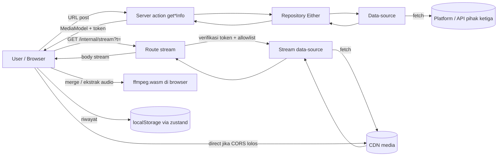
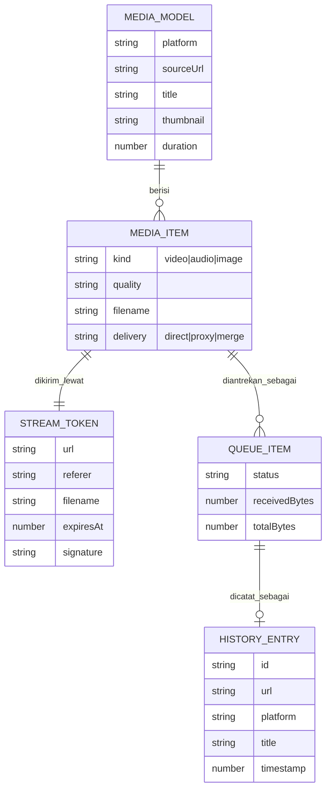
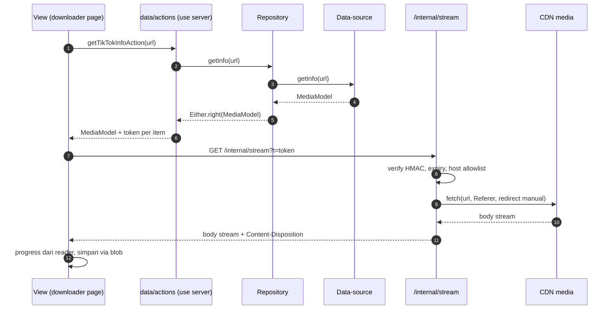
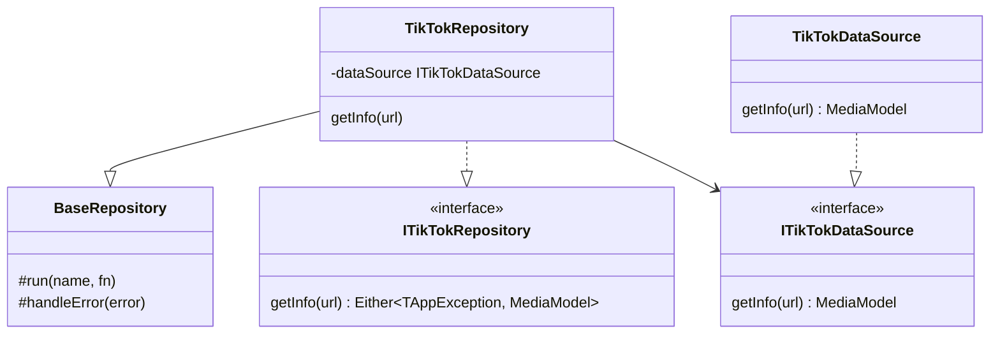

# Migrasi ke Vercel Hobby dengan arsitektur ARCHITECTURE.md

Status: **planning**. Belum ada kode yang diubah. Bagian "Hasil" di akhir diisi saat eksekusi dengan angka nyata.

## 1. Tujuan dan keputusan

| Keputusan | Pilihan | Sumber |
|---|---|---|
| Hosting | Vercel Hobby (gratis), tanpa layanan berbayar | Permintaan user |
| Arsitektur kode | Ikuti `ARCHITECTURE.md` | Permintaan user |
| YouTube 480p ke atas | Gabung video + audio di browser (ffmpeg.wasm) | Permintaan user |
| Audio | Audio asli tanpa konversi (m4a), bukan MP3 | Permintaan user |
| Pengiriman file | Direct dari CDN jika bisa, proxy stream jika perlu | Permintaan user |
| Antislop | Mode during | Permintaan user |

Target: semua platform (YouTube, TikTok, Instagram, Facebook, X, Threads) jalan di Vercel tanpa binary `yt-dlp`, `ffmpeg`, `gallery-dl`, atau `python3`, dan waktu tunggu download lebih pendek dari sekarang.

## 2. Review (kondisi sekarang)

### 2.1 Alur download hari ini

1. Halaman memanggil `prepare*DownloadAction` (`src/actions/*.action.ts`). Action hanya mengembalikan `/internal/download/<platform>?url=...`.
2. Client `POST /internal/progress/start` (`src/core/hooks/use-batch-download.ts:91`).
3. Server `fetch` route miliknya sendiri (`src/core/server/download-job-store.ts:172`). Route menjalankan `yt-dlp -o -` lalu ffmpeg remux (`src/core/server/media-compat.ts:71`).
4. Hasil ditulis ke `os.tmpdir()/saveit-downloads` (`download-job-store.ts:45`, `:184`), lalu file MP4 di-remux sekali lagi dengan `+faststart` (`download-job-store.ts:92-149`).
5. Client polling `/internal/progress/status` tiap 700 ms (`use-batch-download.ts:125-152`), lalu mengunduh `/internal/progress/file` (`use-batch-download.ts:170-175`).

File berpindah dua kali (CDN ke server, server ke browser) dan di-remux dua kali. User menunggu dua kali.

### 2.2 Tabel temuan

| # | Lokasi | Masalah | Dampak di Vercel |
|---|---|---|---|
| 1 | `src/core/services/*.service.ts` (mis. `youtube.service.ts:46`, `:175`) | Semua platform memanggil binary `yt-dlp` lewat `yt-dlp-wrap` | Tidak ada binary di runtime Vercel. Semua info dan download gagal |
| 2 | `src/core/services/social-image.service.ts:473`, `:544-585` | `gallery-dl` dan `python3` + instaloader untuk Instagram dan gambar | Tidak tersedia di Vercel |
| 3 | `src/core/server/media-compat.ts:71`, `src/app/internal/media/video/route.ts:52`, `src/app/internal/media/image/route.ts:69` | ffmpeg untuk remux, MP3, konversi gambar | Tidak tersedia. Remux hanya kompatibilitas; merge HQ YouTube dan Facebook butuh pengganti |
| 4 | `src/core/server/download-job-store.ts:41` | Job store berupa `Map` di memori proses | Tidak dibagi antar invocation. Status dan file sering 404 |
| 5 | `src/core/server/download-job-store.ts:270` | `void runDownloadJob(...)` jalan setelah response | Serverless bisa menghentikan eksekusi setelah response |
| 6 | `src/app/internal/preview/instagram/route.ts:25` | Allowlist host `endsWith` tanpa batas titik, redirect diikuti | SSRF (lead audit run-1 #1). Harus ditutup di desain baru |
| 7 | `src/core/services/social-image.service.ts:899` | URL video dari pihak ketiga tidak divalidasi | SSRF tidak langsung (lead audit run-1 #4) |
| 8 | `src/core/services/youtube.service.ts:187`, `instagram.service.ts:274` | `--no-check-certificate` bersama cookie operator | Hilang otomatis karena yt-dlp dihapus |
| 9 | `src/core/services/youtube.service.ts:301-343` | `getDirectUrls()` sudah ada tapi tidak dipanggil | Ide direct URL sudah pernah dibuat. Bisa jadi acuan |
| 10 | `src/components/image-media-gallery.tsx`, halaman downloader | Opsi audio berlabel MP3 | Harus jadi M4A karena tidak ada transcode |
| 11 | `next.config.ts` | `output: "standalone"`, `images.remotePatterns` tidak dipakai (tidak ada `next/image`) | Standalone tidak dibutuhkan Vercel. remotePatterns sisa |
| 12 | Struktur `src/` | `src/actions`, `src/core/services`, `src/core/utils`, `src/core/hooks` | Belum sesuai layering `ARCHITECTURE.md` (domain, data, common, core) |

### 2.3 Batasan

- **Vercel Hobby.** Tidak ada tagihan overage. Kuota habis membuat project di-pause (503 `DEPLOYMENT_PAUSED`) sampai 30 hari. Hobby hanya untuk non-komersial. Kuota yang paling berpengaruh: Fast Data Transfer (sekitar 100 GB per bulan), durasi function (maks sekitar 300 detik), jumlah invocation. Angka harus dicek ulang di dokumentasi Vercel sebelum deploy.
- **IP datacenter.** YouTube sering memunculkan bot check ke IP Vercel. URL googlevideo bisa terikat IP yang mengekstrak.
- **CDN lintas origin.** Atribut `download` diabaikan untuk URL lintas origin, dan CDN umumnya tidak mengirim `Content-Disposition` atau CORS. Direct download hanya bisa lewat `fetch` + blob ke CDN yang membuka CORS.
- **Endpoint pihak ketiga** (tikwm, snapsave, lovethreads, syndication X) tidak resmi dan bisa berubah.
- **Tidak ada database dan tidak ada login.** Bagian `ARCHITECTURE.md` tentang Postgres, sesi, RBAC, dan network pipeline `ky` tidak berlaku.

## 3. Penerapan ARCHITECTURE.md

| Bagian | Berlaku? | Penerapan |
|---|---|---|
| §2 struktur folder (`app`, `components`, `common`, `core`, `data`, `domain`) | Ya | Struktur target di §4 |
| §3 DI `tsyringe` + vertical slice | Ya | Satu slice per platform |
| §3 Either `fp-ts` | Ya | Repository mengembalikan `Either<TAppException, T>` |
| Logger Pino + `traceId` | Ya | `src/core/services/logger.ts`, dipakai `BaseRepository.run` |
| HMAC `SignatureManager` (`src/core/services/encrypt-manager.ts`) | Ya | Menandatangani token stream |
| §8 Zustand | Sebagian | Hanya riwayat download (dipakai lintas route). Antrean batch tetap hook halaman |
| Lint/format oxlint + oxfmt | Ya, fase terakhir | Ganti ESLint |
| shadcn/ui | Tidak sekarang | Aturan "Component Priority" mendahulukan komponen yang sudah ada |
| Postgres/Drizzle, sesi, RBAC, `proxy.ts`, pipeline `ky` | Tidak | Tidak ada database, login, atau backend API |
| §9 SEO | Tidak diubah | Di luar scope migrasi |

## 4. Struktur target

```text
src/
  app/
    <platform>/page.tsx + <platform>-downloader.tsx   tetap, import diganti
    history/                                         tetap
    internal/stream/route.ts                         BARU, satu-satunya route media
    internal/preview/instagram/route.ts              diperbaiki atau dihapus (lihat F2)
  components/                                        komponen yang ada, dipindah per kategori
  common/
    di/injection.ts                                  container tsyringe
    lib/url-validators.ts, format-helpers.ts         pindahan dari core/utils
    lib/mux.ts                                       ffmpeg.wasm, lazy import, client only
    hooks/use-batch-download.ts                      ditulis ulang tanpa job store
    stores/                                          zustand: slice history
  core/
    handler/exception.ts, types/exception.ts         AppException
    services/logger.ts, encrypt-manager.ts           Pino, HMAC
  domain/
    repositories/<platform>/<platform>.repository.ts kontrak Either
    request/media.request.ts
  data/
    data-sources/<platform>/<platform>.data-source.ts  satu-satunya layer yang fetch
    data-sources/stream/stream.data-source.ts          fetch ke CDN dengan allowlist
    repositories/base-repository.ts, <platform>/...    try/catch ke Either
    actions/<platform>/<platform>.action.ts            "use server"
    models/media/media.model.ts                         satu model media bersama
```

Satu `media.model.ts` bersama, bukan model per platform, karena bentuk info keenam platform sama (judul, thumbnail, durasi, daftar media). Model platform tambahan dibuat hanya jika ada field yang benar-benar beda.

Dihapus: `src/core/server/download-job-store.ts`, `src/core/server/media-compat.ts`, `src/app/internal/progress/*`, `src/app/internal/download/*`, `src/app/internal/media/*`, `src/actions/`, `src/core/services/*.service.ts` (diganti data-source), dependency `yt-dlp-wrap`, `Dockerfile`, `docker-compose.yml`, `.github/workflows/sync-to-hub.yml` dan `docker-ci.yml` (setelah cutover).

## 5. Flow

### 5.1 Flow ambil info

1. User menempel URL. `smart-url-input` memvalidasi dengan `common/lib/url-validators.ts`.
2. Halaman memanggil `get<Platform>InfoAction(url)`.
3. Action resolve `I<Platform>Repository` dari container, repository memanggil data-source.
4. Data-source mengambil info dari sumber tanpa binary (§6) dan mengembalikan `MediaModel`.
5. Untuk tiap item media, action membuat **token stream** bertanda tangan HMAC (URL CDN, Referer, nama file, expiry 15 menit) atau URL direct jika CDN terbukti lolos direct.
6. UI menampilkan info dan tombol unduh.

### 5.2 Flow unduh

1. User memilih kualitas. Item masuk antrean `use-batch-download`.
2. Hook `fetch` ke `/internal/stream?t=<token>` (atau URL direct), membaca body dengan reader untuk progress, lalu menyimpan lewat blob + anchor.
3. Route stream memverifikasi token, memeriksa host CDN (https, batas titik, per platform), memakai `redirect: "manual"`, menolak `Content-Length` di atas batas, lalu meneruskan body apa adanya dengan `Content-Disposition`.
4. Tidak ada file temp, remux, polling, atau job store.

### 5.3 Flow YouTube HQ (480p ke atas)

1. Token dibuat untuk dua stream: video-only dan audio-only.
2. Untuk YouTube, route stream mengekstrak ulang URL di invocation yang sama sebelum fetch, karena URL googlevideo bisa terikat IP.
3. Client mengunduh keduanya, lalu `common/lib/mux.ts` menjalankan ffmpeg.wasm `-c copy` (tanpa re-encode) menjadi satu MP4.

### 5.4 Flow audio

- YouTube: stream audio-only m4a langsung.
- TikTok: URL musik dari tikwm.
- Platform lain: unduh MP4, lalu ffmpeg.wasm `-vn -c:a copy` menjadi `.m4a` di browser.

## 6. Sumber data per platform (pengganti binary)

| Platform | Sumber baru | Catatan |
|---|---|---|
| Threads | lovethreads (sudah ada, `social-image.service.ts:848`) | Tambah validasi URL video (temuan #7) |
| X | `cdn.syndication.twimg.com/tweet-result` | MP4 progressive, tanpa cookie |
| TikTok | `@tobyg74/tiktok-api-dl` dan tikwm (sudah dependency) | Video tanpa watermark dan musik |
| Instagram | Embed `/embed/captioned/` + scrape cheerio (sudah ada) | Reels privat atau Story butuh cookie, mungkin tidak didukung |
| Facebook | snapsave (sudah ada untuk gambar) diperluas ke video | Kualitas tergantung SD/HD yang diberikan snapsave |
| Gambar | Jalur fetch + cheerio yang ada | Konversi JPG/PNG di browser dengan canvas |
| YouTube | `youtubei.js` (dependency baru) | Risiko terbesar. Diuji di F0 |

## 7. Diagram

### 7.1 DFD



### 7.2 ERD (model data, tanpa database)

Aplikasi tidak punya database. Diagram ini menggambarkan bentuk data yang mengalir antar layer dan yang disimpan di browser.



### 7.3 UML sequence (unduh lewat proxy)



### 7.4 UML class (layer satu platform)



## 8. Rekomendasi dan urutan kerja

Rekomendasi: kerjakan **F0 dulu dan berhenti di sana** sampai hasilnya jelas. Jika YouTube tidak bisa diekstrak dari IP Vercel, keputusan full Vercel perlu ditinjau ulang sebelum merombak struktur.

| Fase | Isi | Gerbang |
|---|---|---|
| F0 Spike | Satu route uji di preview Vercel: `youtubei.js`, tikwm, syndication X, snapsave video, lovethreads, embed Instagram. Catat per CDN: CORS, kebutuhan Referer, IP-bound, TTFB | Butuh deploy preview oleh user. Lanjut hanya jika minimal YouTube progressive dan 4 platform lain lolos |
| F1 Fondasi | `tsyringe`, `reflect-metadata`, `fp-ts`, `pino`; `core/handler`, `core/types`, `core/services/logger.ts`, `encrypt-manager.ts`, `common/di/injection.ts`, `data/repositories/base-repository.ts`; pindah `url-validators` dan `format-helpers` ke `common/lib` | `pnpm build` dan test lama hijau |
| F2 Stream | `domain` + `data` untuk stream, route `/internal/stream`, test token dan allowlist; perbaiki `preview/instagram` dengan allowlist yang sama | Test token: valid, kedaluwarsa, diubah, `evilfbcdn.net` ditolak |
| F3 Platform | Slice per platform, urut: Threads, X, TikTok, Instagram, Facebook, gambar, YouTube | Tiap platform: test data-source dengan fetch di-mock |
| F4 Client | Tulis ulang `use-batch-download` (fetch + reader), `common/lib/mux.ts`, label MP3 jadi M4A, slice zustand history | Test hook baru hijau |
| F5 Bersih-bersih | Hapus job store, route lama, `yt-dlp-wrap`, Docker; `next.config.ts` tanpa standalone; oxlint + oxfmt | `pnpm build`, `pnpm lint`, `pnpm test` hijau |
| F6 Deploy | Preview, uji manual tiap platform, cek halaman Usage Vercel, cutover domain | Checklist §9 |

## 9. Hasil yang diharapkan (checklist)

- [ ] F0: tabel hasil spike per platform (ekstraksi lolos atau tidak, direct atau proxy, TTFB).
- [ ] Tidak ada `yt-dlp`, `ffmpeg`, `gallery-dl`, `python3`, atau tulisan ke `/tmp` di kode server.
- [ ] Layering sesuai `ARCHITECTURE.md`: hanya data-source yang `fetch`; repository mengembalikan `Either`; action resolve lewat `injection`.
- [ ] `/internal/stream` menolak token tidak valid, kedaluwarsa, dan host di luar allowlist.
- [ ] Download satu video tiap platform berhasil dan file bisa diputar.
- [ ] YouTube HQ: merge di browser menghasilkan MP4 yang bisa diputar.
- [ ] Audio tersimpan sebagai `.m4a`.
- [ ] Gambar original, JPG, dan PNG tersimpan.
- [ ] Riwayat download tetap muncul di `/history` setelah reload.
- [ ] Waktu sampai byte pertama lebih cepat dari alur lama (angka di bagian Hasil).
- [ ] Pemakaian Fast Data Transfer setelah uji manual tercatat dan masih jauh di bawah kuota Hobby.
- [ ] `pnpm build`, `pnpm lint`, `pnpm test` hijau.
- [ ] `graphify update .` dijalankan setelah kode berubah.

## 10. Risiko

| Risiko | Dampak | Penanganan |
|---|---|---|
| YouTube bot check dari IP Vercel | YouTube tidak jalan | Diuji di F0 sebelum merombak apa pun |
| URL googlevideo terikat IP | Proxy gagal 403 | Ekstrak dan stream dalam satu invocation |
| Endpoint pihak ketiga berubah atau memblokir | Satu platform mati | Satu data-source per sumber, mudah diganti |
| Kuota Hobby habis | Situs di-pause, bukan tagihan | Dahulukan direct, batasi ukuran proxy, rate limit Firewall Vercel yang gratis |
| ffmpeg.wasm berat di HP | Merge lambat atau gagal | Hanya dimuat saat HQ atau audio dipilih |
| Rewrite besar mengikuti ARCHITECTURE.md | Banyak file berubah sekaligus | Per fase, build dan test hijau di tiap gerbang |

## Hasil

### F0 Spike (berjalan)

Kode spike (sementara, dihapus setelah F0 selesai):

- `src/app/internal/spike/route.ts`: GET `?key=&url=`. Mati (404) jika env `SPIKE_KEY` tidak di-set atau key salah. URL divalidasi `isPlatformUrl`. Mengekstrak media tanpa binary, lalu probe tiap URL CDN dari server (Range 1 KB, tanpa Referer, `redirect: "manual"`; ulang dengan Referer jika gagal; ikuti satu redirect).
- `src/app/spike/page.tsx` + `spike-runner.tsx`: halaman `/spike` (noindex) yang memanggil route di atas lalu mencoba fetch URL CDN langsung dari browser untuk mengukur jalur direct.
- Dependency baru: `youtubei.js` 18.3.0. Evaluator decipher dijalankan di `node:vm` context baru tanpa global Node, timeout 5 detik.

Verifikasi lokal (IP rumahan, bukan IP Vercel):

| Cek | Hasil |
|---|---|
| `pnpm exec tsc --noEmit` | Lolos, 0 error |
| `pnpm build` | Lolos, route `/internal/spike` dan `/spike` terdaftar |
| `pnpm test` | 12 suite, 180 test lolos |
| `eslint` file spike | 0 temuan |
| Route tanpa key | 404 |

YouTube `dQw4w9WgXcQ` dari IP lokal (ekstraksi 15 kombinasi client dan format: 3,8 detik):

| Client | Progressive (video+audio) | Video 1080p | Audio |
|---|---|---|---|
| WEB | 403 | gagal decipher | gagal decipher |
| MWEB | 403 | 403 | 403 |
| IOS | tidak ada format | 206 | 206 |
| ANDROID | 206 | gagal decipher | gagal decipher |
| TV | streaming data tidak tersedia | sama | sama |

Temuan lokal:

- Semua URL googlevideo membawa parameter `ip` (terikat IP) dan **tidak** mengirim `Access-Control-Allow-Origin`. YouTube harus lewat proxy dan diekstrak di invocation yang sama dengan stream, sesuai §5.3.
- Kombinasi yang jalan: `ANDROID` untuk progressive, `IOS` untuk video 1080p dan audio. Ini cukup untuk alur HQ (merge di browser).
- Platform lain belum diuji: butuh contoh URL post publik yang berisi video.

Deploy spike ke Vercel: `vercel deploy --temporary` (tanpa login) dengan env `SPIKE_KEY` acak, file besar dikecualikan lewat `.vercelignore`. URL: `https://video-downloader-eight-eta.vercel.app`, region function `iad1`. Build Vercel lolos. Route tanpa key: 404.

YouTube `dQw4w9WgXcQ` dari IP Vercel `iad1` (ekstraksi 15 kombinasi: 5,5 detik):

| Client | Progressive (video+audio) | Video 1080p | Audio |
|---|---|---|---|
| WEB | 403 | gagal decipher | gagal decipher |
| MWEB | 403 | 403 | 403 |
| IOS | tidak ada format | 206 | 206 |
| ANDROID | 206 | gagal decipher | gagal decipher |
| TV | streaming data tidak tersedia | sama | sama |

Kesimpulan YouTube: **lolos gerbang F0**. Tidak ada bot check dari IP Vercel untuk video publik ini. Pakai `ANDROID` untuk progressive, `IOS` untuk 1080p dan audio, semuanya lewat proxy (URL terikat IP, tanpa CORS). Produksi cukup satu atau dua kombinasi per request, jadi waktu ekstraksi jauh di bawah 5,5 detik.

Belum: TikTok, Instagram, Facebook, X, Threads (menunggu contoh URL post publik), dan uji direct dari browser lewat halaman `/spike`.
